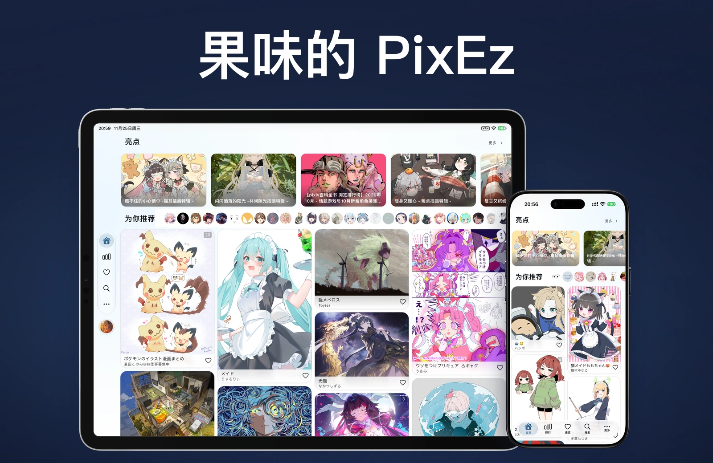
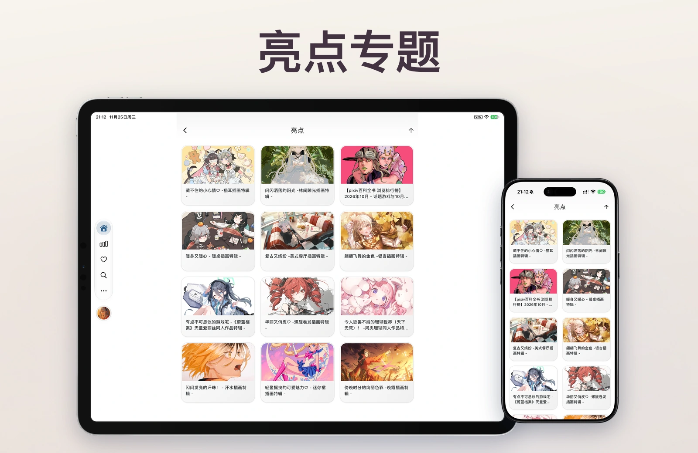
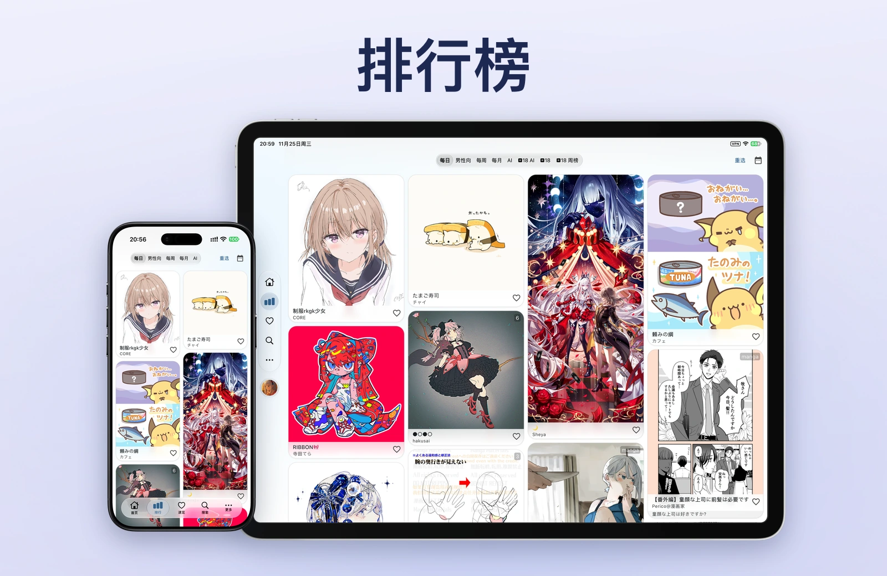
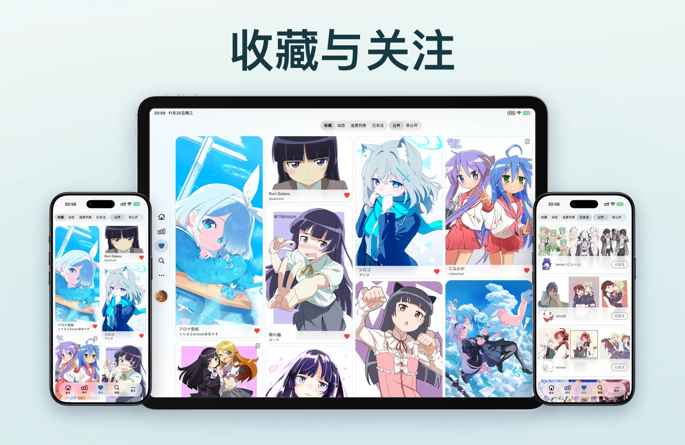
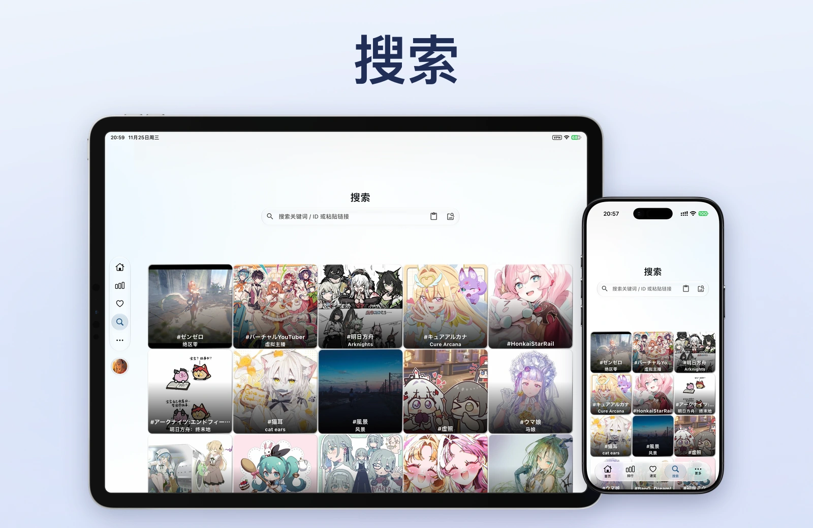
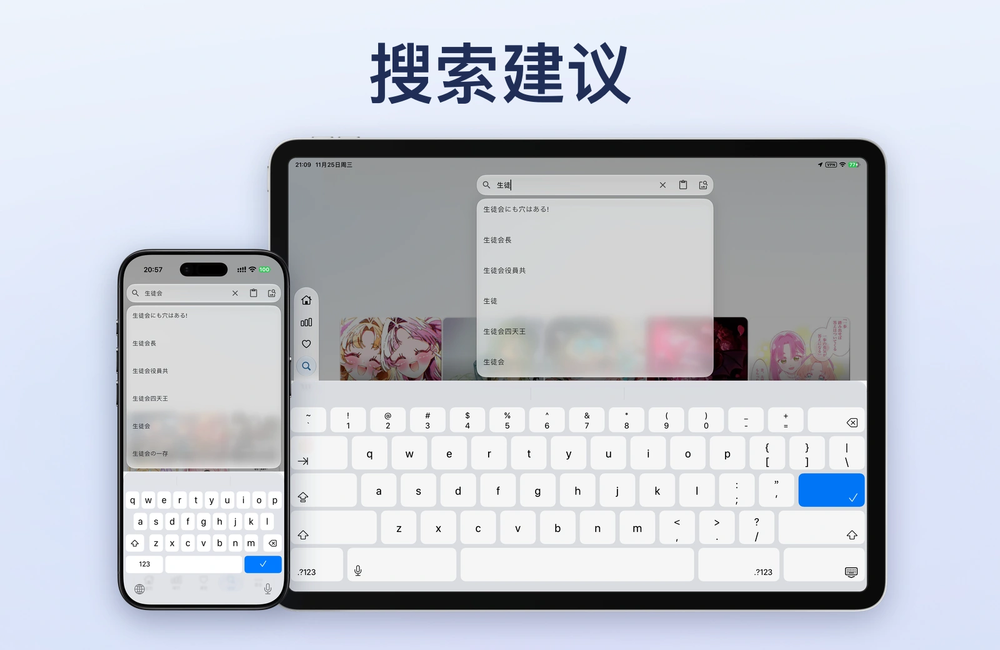

<div align="center">

[简体中文](README.md) · **English** · [日本語](README.ja.md) · [한국어](README.ko.md)


# PixAP

**PixEz with an Apple touch, for iPhone, iPad, and Mac.**

PixAP is a third-party pixiv client based on PixEz Flutter. It brings floating navigation to iPhone and iPad and redesigns search, artwork previews, and preferences for Apple devices.

[Download the iOS IPA](https://github.com/Duke486/PixAP/releases/download/v1.9.90-build517/PixAP-iOS.ipa) · [Installation](#installation) · [Build from source](#build-from-source) · [Report an issue](https://github.com/Duke486/PixAP/issues)

</div>



## Interface design

- **Reflective cards.** PixAP samples the bottom edge of an illustration or an artist’s preview, then blurs the reflection and fades it into the title area. The color follows the image, with separate reflection strengths for light and dark modes. You can see it on artwork cards in Home, Rankings, and Collections, and on artist cards in Following.
- **Floating glass.** Native Liquid Glass is available on iOS and iPadOS 26 or later. On iPhone, the selected capsule in the bottom bar follows your swipe between tabs. On iPad, navigation moves to the left to give the gallery the full height of the display. The top bars in Rankings and Favorites fade into the gallery as artwork scrolls underneath.
- **A moving Pixiv blue glow.** The main tabs share a faint blue glow that drifts in the background. Turn on the system’s Reduce Motion setting to keep it still.

**Home** first shows the recommendations from your previous session. After an automatic refresh, you have three seconds to undo it from the prompt.

## Highlights



Open **Home → Highlights → More**. Articles appear in two columns on iPhone and three on iPad, with consistent cover proportions and title heights. The grid scrolls beneath a top bar that fades into the content.

## Rankings



Open **Rankings** and use the glass control at the top to switch charts. Tap the calendar button to pick a date with the system date picker.

## Collections and following



Open the heart-shaped **Favorites** tab to switch between Collections and Following. The floating toolbar places the public and private filters beside the view selector. iPad lays out artwork in a multicolumn gallery, and the Following view shows a preview of each artist’s work.

## Artist profiles


Tap an artist card in **Favorites → Following**, or tap the artist’s avatar on an artwork page. Banners, floating controls, and galleries are laid out separately for iPhone and iPad. On iPad, the profile sits in the center and the artwork spreads across multiple columns.

## Search





**Search** presents recommended tags in a grid of artwork covers. The old cover stays visible while the new one loads, then the new one fades in. Tap the search field to move it to the top and show suggestions above the keyboard. Tap the image-search button to pick an image from Photos or Files and preview it before submitting.

## R18 content display


Open **More → Preferences → NSFW content display**. PixAP can cover artwork cards with a particle mask that preserves their overall colors and shapes. You can also choose **Replace image** or **Show**.

## Two-pane preferences


Open **More → Preferences**. On iPad, the settings sidebar stays visible beside the current pane. Set image quality separately for artwork cards, illustration details, manga details, and full-screen viewing. You can also choose the launch tab or enable **Swipe back from the right edge** in artwork details and full-screen viewing.

## Artwork and screenshot credits

The posters and screenshots show artwork, manga, work titles, artist names, and related material solely to demonstrate PixAP. Thank you to the creators. Copyright remains with the respective rights holders. If any material infringes your rights, please contact the maintainer through [GitHub Issues](https://github.com/Duke486/PixAP/issues) so it can be removed.

## Installation

Download `PixAP-iOS.ipa` from [PixAP 1.9.90 (517)](https://github.com/Duke486/PixAP/releases/tag/v1.9.90-build517). The unsigned IPA supports both iPhone and iPad. Use your preferred signing tool before installing or updating the app. Native Liquid Glass requires iOS or iPadOS 26 or later.

## Build from source

Use Xcode with the iOS 26 SDK or later, the Flutter version pinned in [mise.toml](mise.toml), and the Rust toolchain. The [example iOS build workflow](docs/build-workflows/build_ios.yml) builds an unsigned device app.

```sh
flutter pub get
(cd plugins/rhttp/rhttp && flutter pub get && dart run build_runner build)
dart run build_runner build
flutter build ios --release --no-codesign
```

The Xcode project uses the [Flutter build script](ios/Flutter/build_with_xcode.sh). The release tag includes the source used to build the IPA. On macOS 12 or later, configure your Mac signing settings and run `flutter build macos --release`.

## Source, acknowledgments, and license

[Perol_Notsfsssf](https://github.com/Notsfsssf) created [PixEz Flutter](https://github.com/Notsfsssf/pixez-flutter). [Duke486](https://github.com/Duke486) develops and independently maintains PixAP as a fork of that project. The upstream baseline is [`f11be4dd`](https://github.com/Notsfsssf/pixez-flutter/commit/f11be4ddf03775175006e4b3ebd70c446961f4e6).

PixAP has no official affiliation with Apple, pixiv, or the upstream project. The source is released under the [GNU GPL v3](LICENSE). The source and third-party component directories retain the original copyright and license notices.

### Upstream author and contributors

Thank you to the author of PixEz Flutter and everyone who contributed to the project.

<table>
  <tr>
    <td align="center"><a href="https://github.com/Notsfsssf"><br /><sub><b>Perol_Notsfsssf</b></sub></a><br /><a href="https://github.com/Skimige/pixez-flutter/commits?author=Notsfsssf" title="Code">💻</a></td>
    <td align="center"><a href="https://xyx.moe"><br /><sub><b>Skimige</b></sub></a><br /><a href="https://github.com/Skimige/pixez-flutter/commits?author=Skimige" title="Documentation">📖</a></td>
    <td align="center"><a href="https://github.com/TragicLifeHu"><br /><sub><b>Tragic Life</b></sub></a><br />🌍</td>
    <td align="center"><a href="http://ivtune.net"><br /><sub><b>karin722</b></sub></a><br />🌍</td>
    <td align="center"><a href="http://archman.fun"><br /><sub><b>Romani-Archman</b></sub></a><br /><a href="https://github.com/Skimige/pixez-flutter/commits?author=Romani-Archman" title="Documentation">📖</a></td>
    <td align="center"><a href="https://github.com/itzXian"><br /><sub><b>Xian</b></sub></a><br />🌍</td>
    <td align="center"><a href="https://github.com/ReikiAigawara"><br /><sub><b>Reiki Aigawara</b></sub></a><br />🌍</td>
  </tr>
</table>

[Upstream FAQ](https://github.com/Notsfsssf/pixez-flutter/blob/master/.github/FAQ.md)
