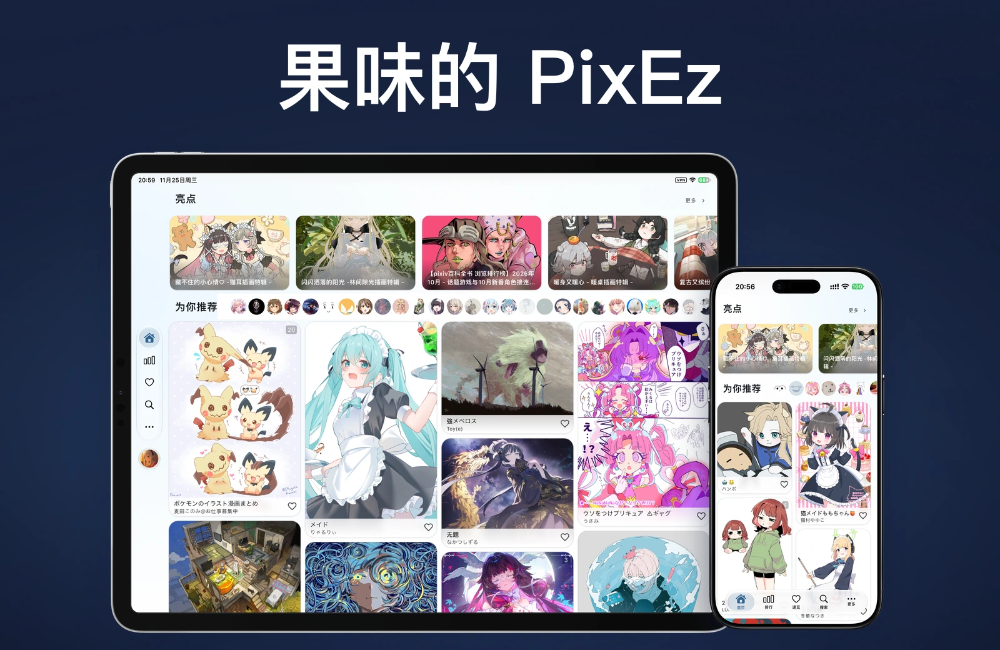
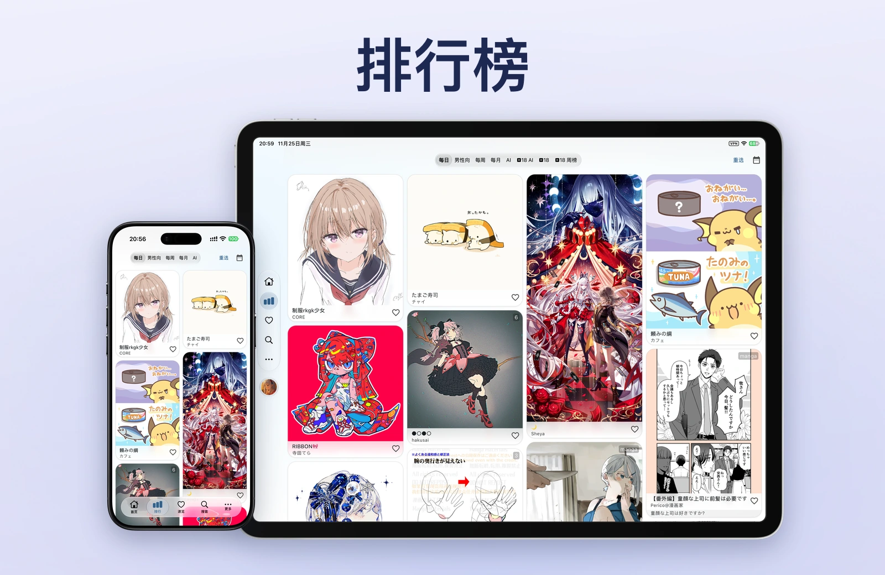
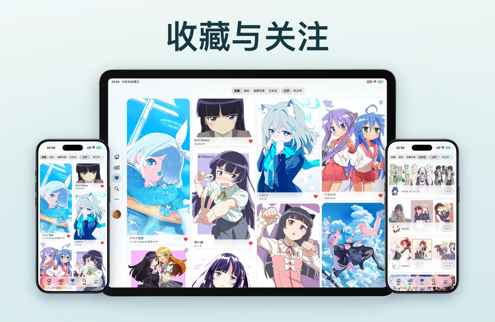
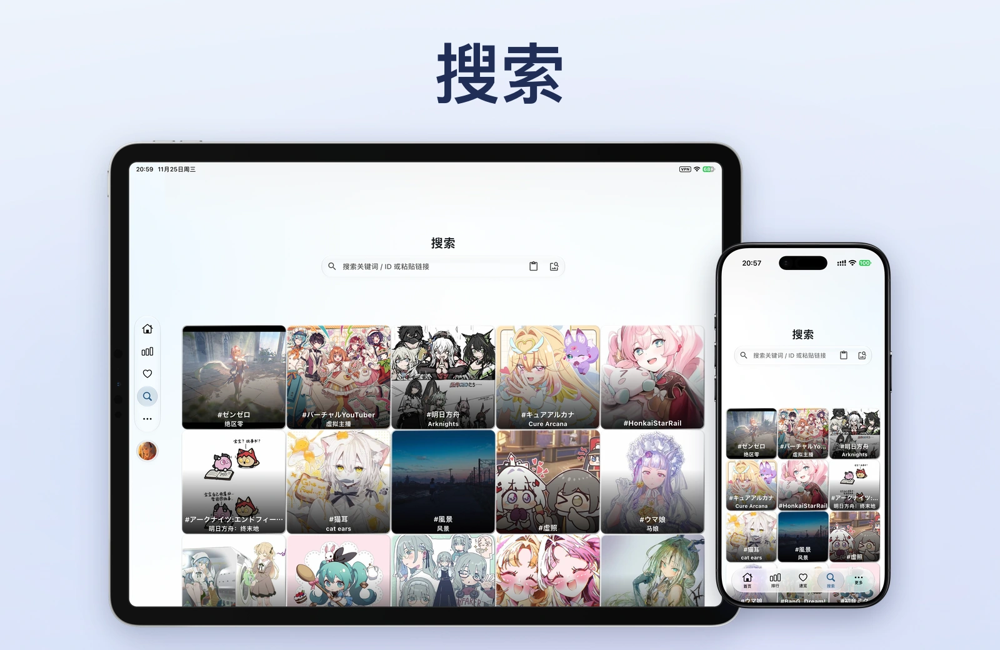
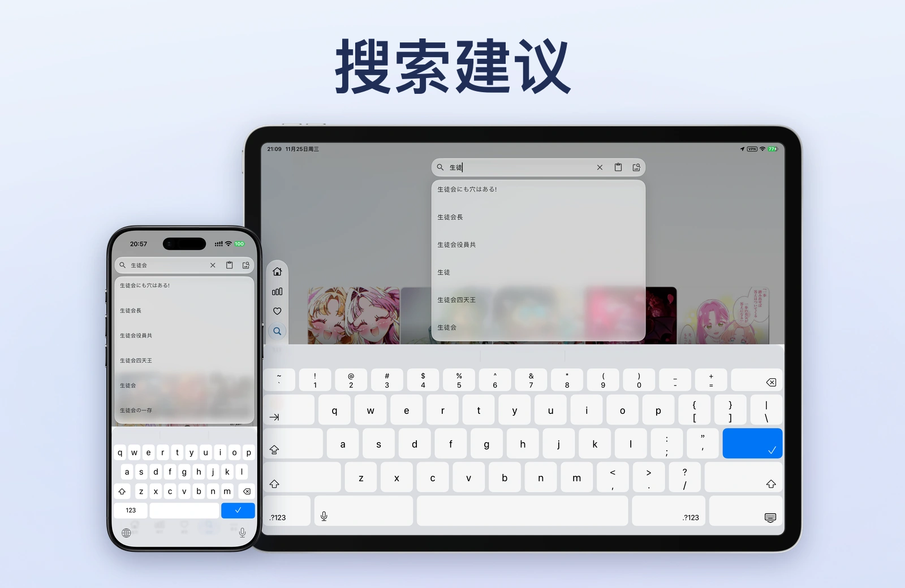
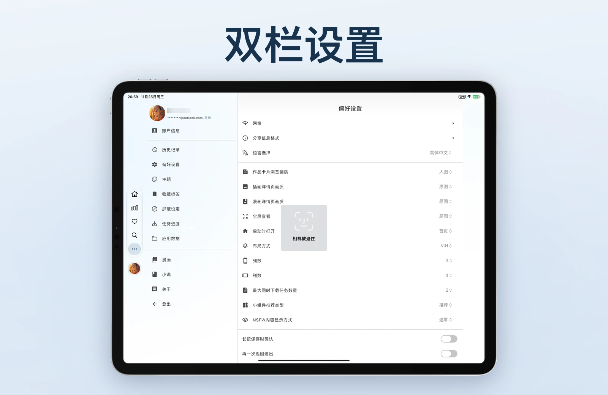

<div align="center">

[简体中文](README.md) · [English](README.en.md) · **日本語** · [한국어](README.ko.md)


# PixAP

**Apple らしさを取り入れた PixEz。iPhone、iPad、Mac に対応。**

PixAP は PixEz Flutter をベースにした非公式の pixiv クライアントです。iPhone と iPad にフローティングナビゲーションを採用し、検索、作品のプレビュー、設定を Apple デバイス向けに再設計しました。

[iOS 用 IPA をダウンロード](https://github.com/Duke486/PixAP/releases/download/v1.9.90-build517/PixAP-iOS.ipa) · [インストール](#インストール) · [ソースからビルド](#ソースからビルド) · [不具合を報告](https://github.com/Duke486/PixAP/issues)

</div>



## インターフェースのデザイン

- **光を映すカード**。イラストの表紙や作者の作品プレビューの下端を取り込み、ぼかした反射をタイトル欄に重ねます。色は画像ごとに異なり、反射の強さはライトモードとダークモードで変わります。ホーム、ランキング、ブックマークの作品カードや、「フォロー中」の作者カードで見られます。
- **フローティングガラス**。iOS／iPadOS 26 以降では、ネイティブの Liquid Glass を使用します。iPhone では横スワイプによる画面の切り替えに合わせて、下部バーの選択表示が移動します。iPad ではナビゲーションを左に置き、ギャラリーが画面の高さを使えるようにしています。ランキングとブクマの上部バーは下に向かって透明になり、その下を作品がスクロールします。
- **ゆっくり動く Pixiv ブルー**。iPhone と iPad のメイン画面には、淡い青の光がゆっくりと流れます。システムの「視差効果を減らす」をオンにすると静止します。

**ホーム**では、最初に前回のおすすめ作品を表示します。自動更新後は、通知が表示されてから 3 秒以内に取り消せます。

## ハイライト


**ホーム → ハイライト → もっと見る** で特集一覧を開けます。iPhone では 2 列、iPad では 3 列で表示します。表紙の比率とタイトル欄の高さをそろえ、一覧はぼかしが徐々に薄くなる上部バーの下をスクロールします。

## ランキング



**ランキング**の上部にあるガラスの切り替えボタンで、表示するランキングを選べます。カレンダーボタンをタップすると、システムの日付選択画面で日付を指定できます。

## ブックマークとフォロー



ハートの **ブクマ** を開き、上部から「ブックマーク」と「フォロー中」を切り替えられます。表示の切り替えと公開・非公開のフィルターをフローティングバーにまとめました。iPad では作品を複数列で表示し、「フォロー中」では作者ごとに作品をプレビューできます。

## 作者プロフィール


**ブクマ → フォロー中** の作者カード、または作品詳細の作者アイコンをタップします。バナー、フローティングの操作ボタン、作品一覧は iPhone と iPad それぞれに合わせて配置しています。iPad ではプロフィールを中央に置き、作品を複数列に並べます。

## 検索





**検索**では、おすすめタグを作品の表紙と一緒に表示します。新しい画像の読み込みが終わるまで元の表紙を表示し、準備できた画像にフェードで切り替えます。入力欄をタップすると検索バーが上に移動し、キーボードの上に候補が表示されます。画像検索ボタンから「写真」や「ファイル」の画像を選び、プレビューしてから送信できます。

## R18 コンテンツの表示


**もっと見る → 設定 → NSFWコンテンツの表示方法** を開きます。画像全体の色合いや形を残したまま、作品カードをパーティクルのマスクで覆えます。「画像を置き換える」または「表示」も選べます。

## 2 ペインの設定



**もっと見る → 設定** を開きます。iPad では設定項目の一覧と選択中の画面を同時に表示します。作品カード、イラスト詳細、マンガ詳細、全画面表示の画質を個別に設定できます。起動時に開く画面の選択や、作品詳細と全画面表示での「右端からのスワイプで戻る」にも対応しています。

## 作品とスクリーンショットについて

ポスターやスクリーンショット内のイラスト、マンガ、作品名、作者名などは、PixAP の画面と機能の紹介にのみ使用しています。作者の皆さまに感謝します。著作権はそれぞれの権利者に帰属します。権利を侵害する内容があれば、[GitHub Issues](https://github.com/Duke486/PixAP/issues) から管理者にご連絡ください。該当する内容を削除します。

## インストール

[PixAP 1.9.90（517）](https://github.com/Duke486/PixAP/releases/tag/v1.9.90-build517) から `PixAP-iOS.ipa` をダウンロードします。IPA は iPhone と iPad に対応する未署名版です。お使いの署名ツールで署名してから、新規インストールまたは上書きインストールしてください。ネイティブの Liquid Glass には iOS または iPadOS 26 以降が必要です。

## ソースからビルド

iOS 26 以降の SDK を含む Xcode、[mise.toml](mise.toml) に指定されたバージョンの Flutter、Rust ツールチェーンを使います。未署名の実機向けアプリをビルドする手順は、[iOS ビルドワークフローの例](docs/build-workflows/build_ios.yml) にあります。

```sh
flutter pub get
(cd plugins/rhttp/rhttp && flutter pub get && dart run build_runner build)
dart run build_runner build
flutter build ios --release --no-codesign
```

Xcode プロジェクトは [Flutter ビルドスクリプト](ios/Flutter/build_with_xcode.sh) を使います。IPA に対応するソースはリリースタグにあります。macOS 12 以降では、Mac の署名を設定してから `flutter build macos --release` を実行します。

## ソース、謝辞、ライセンス

[PixEz Flutter](https://github.com/Notsfsssf/pixez-flutter) は [Perol_Notsfsssf](https://github.com/Notsfsssf) が開発を始めました。PixAP はそのフォークで、[Duke486](https://github.com/Duke486) が独立して開発・メンテナンスしています。派生元のコミットは [`f11be4dd`](https://github.com/Notsfsssf/pixez-flutter/commit/f11be4ddf03775175006e4b3ebd70c446961f4e6) です。

PixAP は Apple、pixiv、派生元プロジェクトの公式アプリではありません。ソースコードは [GNU GPL v3](LICENSE) で公開しています。元の著作権表示とライセンス表示はソースおよびサードパーティーコンポーネントのディレクトリに記載されています。

### 派生元の作者とコントリビューター

PixEz Flutter の作者と、プロジェクトに貢献した皆さまに感謝します。

<table>
  <tr>
    <td align="center"><a href="https://github.com/Notsfsssf"><br /><sub><b>Perol_Notsfsssf</b></sub></a><br /><a href="https://github.com/Skimige/pixez-flutter/commits?author=Notsfsssf" title="Code">💻</a></td>
    <td align="center"><a href="https://xyx.moe"><br /><sub><b>Skimige</b></sub></a><br /><a href="https://github.com/Skimige/pixez-flutter/commits?author=Skimige" title="Documentation">📖</a></td>
    <td align="center"><a href="https://github.com/TragicLifeHu"><br /><sub><b>Tragic Life</b></sub></a><br />🌍</td>
    <td align="center"><a href="http://ivtune.net"><br /><sub><b>karin722</b></sub></a><br />🌍</td>
    <td align="center"><a href="http://archman.fun"><br /><sub><b>Romani-Archman</b></sub></a><br /><a href="https://github.com/Skimige/pixez-flutter/commits?author=Romani-Archman" title="Documentation">📖</a></td>
    <td align="center"><a href="https://github.com/itzXian"><br /><sub><b>Xian</b></sub></a><br />🌍</td>
    <td align="center"><a href="https://github.com/ReikiAigawara"><br /><sub><b>Reiki Aigawara</b></sub></a><br />🌍</td>
  </tr>
</table>

[派生元のよくある質問](https://github.com/Notsfsssf/pixez-flutter/blob/master/.github/FAQ.md)
