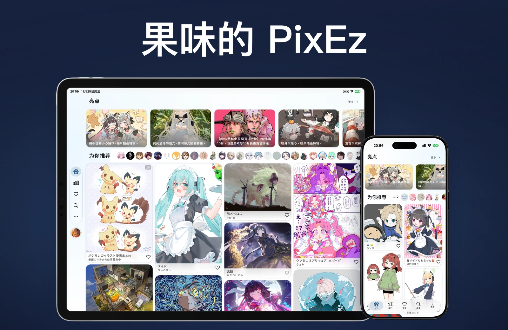
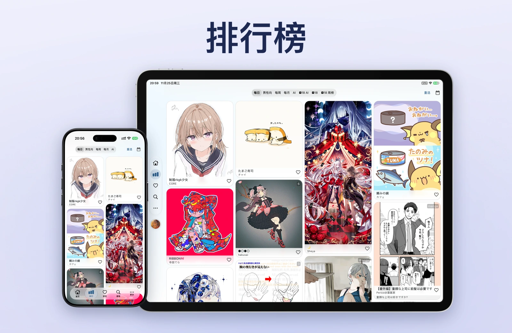
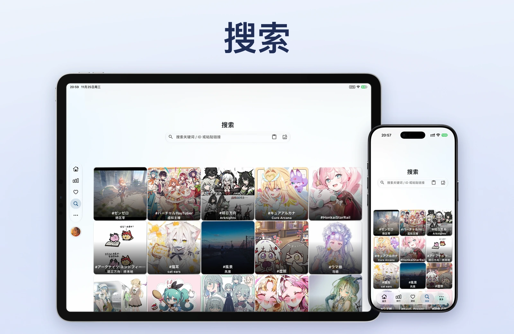
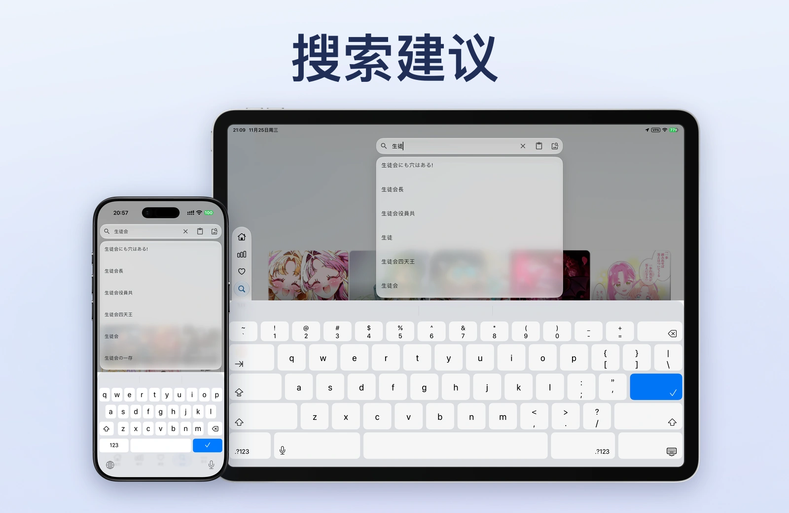
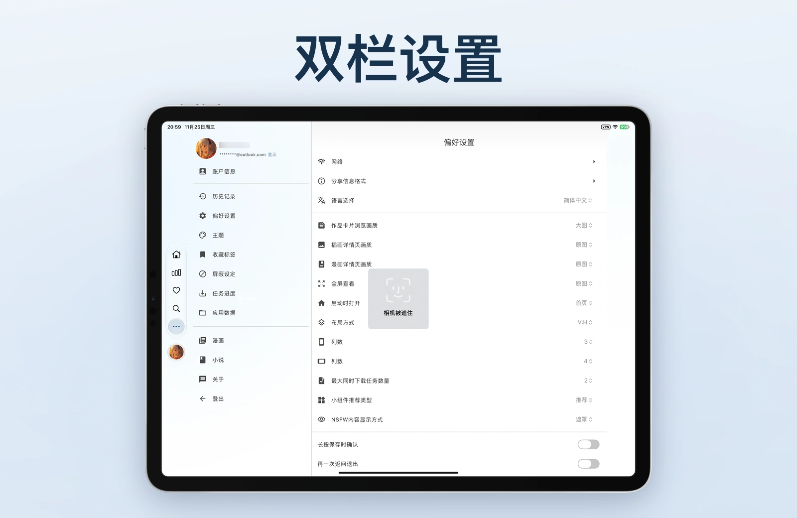

<div align="center">

[简体中文](README.md) · [English](README.en.md) · [日本語](README.ja.md) · **한국어**


# PixAP

**Apple의 감각을 담은 PixEz. iPhone, iPad, Mac에서.**

PixAP는 PixEz Flutter를 바탕으로 만든 비공식 pixiv 클라이언트입니다. iPhone과 iPad에 떠 있는 탐색 막대를 적용하고, 검색과 작품 미리보기, 설정 화면을 Apple 기기에 맞춰 다시 설계했습니다.

[iOS IPA 다운로드](https://github.com/Duke486/PixAP/releases/download/v1.9.90-build517/PixAP-iOS.ipa) · [설치](#설치) · [소스에서 빌드](#소스에서-빌드) · [문제 신고](https://github.com/Duke486/PixAP/issues)

</div>



## 인터페이스 디자인

- **빛을 담는 카드**. 일러스트 표지나 작가의 작품 미리보기 하단을 추출한 뒤, 반사광을 흐리게 처리해 제목 영역에 자연스럽게 섞습니다. 이미지마다 색감이 달라지며 라이트 모드와 다크 모드에서 반사 강도를 다르게 적용합니다. 홈, 랭킹, 북마크의 작품 카드와 팔로우 중인 작가의 카드에서 볼 수 있습니다.
- **떠 있는 유리 탐색 막대**. iOS 및 iPadOS 26 이상에서 네이티브 Liquid Glass를 사용합니다. iPhone에서는 좌우로 쓸어넘길 때 선택 표시가 하단 막대에서 함께 움직입니다. iPad에서는 탐색 메뉴를 왼쪽에 배치해 갤러리가 화면 높이를 활용합니다. 랭킹과 북마크의 상단 막대는 아래로 갈수록 투명해지고, 그 아래로 작품이 스크롤됩니다.
- **천천히 흐르는 Pixiv 블루**. iPhone과 iPad의 주요 화면에는 은은한 파란빛이 천천히 움직입니다. 시스템의 ‘동작 줄이기’를 켜면 빛이 움직이지 않습니다.

**홈**을 열면 지난번에 본 추천 작품을 먼저 표시합니다. 자동으로 새로고침한 후에는 안내가 표시된 시점부터 3초 안에 실행을 취소할 수 있습니다.

## 하이라이트


**홈 → 하이라이트 → 더 보기**에서 특집 목록을 열 수 있습니다. iPhone에서는 두 열, iPad에서는 세 열로 표시하며 표지 비율과 제목 영역 높이를 맞췄습니다. 목록은 흐림 효과가 아래로 갈수록 옅어지는 상단 막대 뒤로 스크롤됩니다.

## 랭킹



**랭킹** 화면 상단의 유리 컨트롤에서 순위표를 바꿀 수 있습니다. 달력 아이콘을 누르면 시스템 날짜 선택기에서 원하는 날짜를 지정할 수 있습니다.

## 북마크와 팔로우


하트 모양의 **북마크** 탭을 열고 상단에서 ‘북마크’와 ‘팔로우 중’을 전환할 수 있습니다. 떠 있는 막대에서 화면 선택 메뉴와 공개·비공개 필터를 함께 제공합니다. iPad에서는 작품을 여러 열로 표시하며, 팔로우 중인 작가의 작품은 미리보기로 볼 수 있습니다.

## 작가 프로필


**북마크 → 팔로우 중**에서 작가 카드를 누르거나 작품 상세 화면에서 작가 아바타를 누릅니다. 배너, 떠 있는 조작 버튼, 작품 갤러리는 iPhone과 iPad에 맞춰 각각 배치했습니다. iPad에서는 작가 소개를 가운데에 두고 작품을 여러 열로 펼칩니다.

## 검색





**검색**에서는 추천 태그를 작품 표지와 함께 보여 줍니다. 새 이미지가 준비될 때까지 기존 표지를 유지한 후 부드럽게 전환합니다. 입력란을 누르면 검색 막대가 위로 이동하고 키보드 위에 추천 검색어가 나타납니다. 이미지 검색 버튼을 누르면 사진 또는 파일에서 이미지를 골라 미리 본 뒤 제출할 수 있습니다.

## R18 콘텐츠 표시


**더 보기 → 설정 → NSFW 콘텐츠 표시 방식**을 엽니다. 입자 마스크로 작품을 가리면서도 이미지의 전체적인 색감과 윤곽은 남길 수 있습니다. ‘이미지 바꾸기’나 ‘표시’도 선택할 수 있습니다.

## 두 패널로 구성된 설정



**더 보기 → 설정**을 엽니다. iPad에서는 설정 목록과 선택한 항목을 동시에 볼 수 있습니다. 작품 카드, 일러스트 상세, 만화 상세, 전체 화면의 화질을 따로 지정할 수 있습니다. 시작할 때 열 화면을 고르거나, 작품 상세와 전체 화면에서 ‘오른쪽 가장자리에서 스와이프하여 뒤로 가기’를 켤 수도 있습니다.

## 작품 및 스크린샷 크레디트

포스터와 스크린샷에 등장하는 일러스트, 만화, 작품 제목, 작가 이름 및 관련 콘텐츠는 PixAP의 화면과 기능을 보여 주기 위한 용도로만 사용했습니다. 모든 창작자에게 감사드립니다. 저작권은 각 권리자에게 있습니다. 권리를 침해하는 내용이 있다면 [GitHub Issues](https://github.com/Duke486/PixAP/issues)로 알려 주세요. 해당 내용을 삭제하겠습니다.

## 설치

[PixAP 1.9.90 (517)](https://github.com/Duke486/PixAP/releases/tag/v1.9.90-build517)에서 `PixAP-iOS.ipa`를 다운로드합니다. IPA는 iPhone과 iPad에서 사용할 수 있는 미서명 패키지입니다. 사용하는 서명 도구로 서명한 뒤 새로 설치하거나 기존 앱을 업데이트하세요. 네이티브 Liquid Glass는 iOS 또는 iPadOS 26 이상에서 사용할 수 있습니다.

## 소스에서 빌드

iOS 26 이상 SDK가 포함된 Xcode, [mise.toml](mise.toml)에 지정된 버전의 Flutter, Rust 도구 체인이 필요합니다. 기기용 미서명 앱을 빌드하는 절차는 [iOS 빌드 워크플로 예시](docs/build-workflows/build_ios.yml)를 참고하세요.

```sh
flutter pub get
(cd plugins/rhttp/rhttp && flutter pub get && dart run build_runner build)
dart run build_runner build
flutter build ios --release --no-codesign
```

Xcode 프로젝트는 [Flutter 빌드 스크립트](ios/Flutter/build_with_xcode.sh)를 사용합니다. IPA에 해당하는 소스는 릴리스 태그에서 볼 수 있습니다. macOS 12 이상에서는 Mac 서명을 설정한 뒤 `flutter build macos --release`를 실행합니다.

## 소스, 감사의 말, 라이선스

[PixEz Flutter](https://github.com/Notsfsssf/pixez-flutter)는 [Perol_Notsfsssf](https://github.com/Notsfsssf)가 만들었습니다. PixAP는 그 프로젝트의 포크이며 [Duke486](https://github.com/Duke486)이 독립적으로 개발하고 유지 관리합니다. 원본 프로젝트의 기준 커밋은 [`f11be4dd`](https://github.com/Notsfsssf/pixez-flutter/commit/f11be4ddf03775175006e4b3ebd70c446961f4e6)입니다.

PixAP는 Apple, pixiv 또는 원본 프로젝트와 공식적인 관계가 없습니다. 소스는 [GNU GPL v3](LICENSE)로 공개합니다. 원래의 저작권 및 라이선스 표기는 소스와 서드파티 구성요소 디렉터리에 있습니다.

### 원작자와 기여자

PixEz Flutter의 원작자와 프로젝트에 기여해 주신 모든 분께 감사드립니다.

<table>
  <tr>
    <td align="center"><a href="https://github.com/Notsfsssf"><br /><sub><b>Perol_Notsfsssf</b></sub></a><br /><a href="https://github.com/Skimige/pixez-flutter/commits?author=Notsfsssf" title="Code">💻</a></td>
    <td align="center"><a href="https://xyx.moe"><br /><sub><b>Skimige</b></sub></a><br /><a href="https://github.com/Skimige/pixez-flutter/commits?author=Skimige" title="Documentation">📖</a></td>
    <td align="center"><a href="https://github.com/TragicLifeHu"><br /><sub><b>Tragic Life</b></sub></a><br />🌍</td>
    <td align="center"><a href="http://ivtune.net"><br /><sub><b>karin722</b></sub></a><br />🌍</td>
    <td align="center"><a href="http://archman.fun"><br /><sub><b>Romani-Archman</b></sub></a><br /><a href="https://github.com/Skimige/pixez-flutter/commits?author=Romani-Archman" title="Documentation">📖</a></td>
    <td align="center"><a href="https://github.com/itzXian"><br /><sub><b>Xian</b></sub></a><br />🌍</td>
    <td align="center"><a href="https://github.com/ReikiAigawara"><br /><sub><b>Reiki Aigawara</b></sub></a><br />🌍</td>
  </tr>
</table>

[원본 프로젝트의 자주 묻는 질문](https://github.com/Notsfsssf/pixez-flutter/blob/master/.github/FAQ.md)
