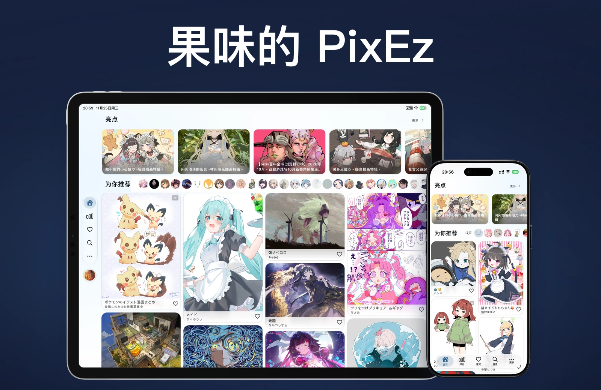
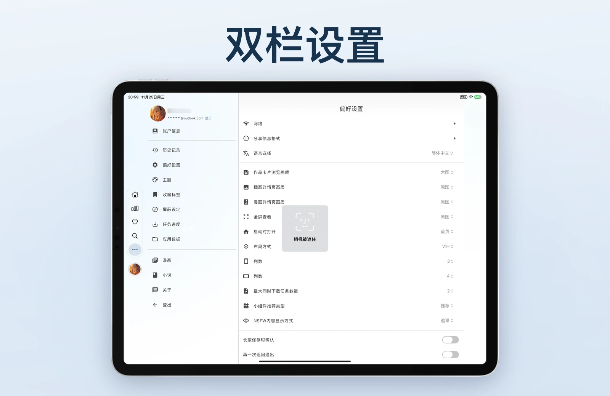

<div align="center">


# PixAP

**给 iPhone、iPad 和 Mac 的果味 PixEz。**

PixAP 是基于 PixEz Flutter 改造的第三方 pixiv 客户端。iPhone 的底栏和 iPad 的侧栏随画廊浮动，搜索、作品预览和设置按 Apple 设备的屏幕与操作习惯重新设计。

[下载 iOS IPA](https://github.com/Duke486/PixAP/releases/download/v1.9.90-build517/PixAP-iOS.ipa) · [安装说明](#安装) · [从源码构建](#从源码构建) · [问题反馈](https://github.com/Duke486/PixAP/issues)

</div>



## 界面设计

- **光感卡片**。从插画封面或作者作品预览的底边取色，将倒影模糊后淡入标题区。每张卡片的色泽随图片变化，深浅色模式使用各自的反光强度。首页、排行、收藏的作品卡，以及「已关注」里的作者卡都能看到。
- **悬浮玻璃**。iOS / iPadOS 26 起使用原生 Liquid Glass。iPhone 把导航放在底部，横滑换页时选中胶囊随手势移动。iPad 把切换入口放在左侧，让多列画廊用足纵向空间。排行和速览的顶栏从上往下渐隐，作品滚过时仍能看清分段控件。
- **流动的 Pixiv 蓝**。iPhone 和 iPad 的一级页面共用一层低透明度的蓝色光晕。光晕缓慢移动，开启系统的「减弱动态效果」时保持静止。

打开 **首页** 时，PixAP 先显示上次的推荐内容。自动刷新后，可以在提示出现的 3 秒内撤销。

## 亮点专题


在 **首页 → 亮点 → 更多** 打开专题列表。PixAP 在 iPhone 上排成两列，在 iPad 上排成三列，统一封面比例与标题高度。滚动时，内容从逐渐模糊的顶栏下方经过。

## 排行


从 **排行** 进入，顶部的玻璃分段可以直接切换榜单。点右侧日历，用系统日期选择器打开指定日期的排行。

## 收藏与关注


进入心形图标 **速览**，在顶部切换「收藏」和「已关注」。PixAP 重做了这里的悬浮工具栏，把公开和非公开筛选放在分段旁边。iPad 上的作品铺成多列画廊，已关注的作者以作品预览呈现。

## 作者主页


在 **速览 → 已关注** 点作者卡片，或从作品详情点作者头像。PixAP 为 iPhone 和 iPad 分别排布作者横幅、浮动工具栏与作品画廊。iPad 把作者资料放在中间，作品区展开为多列。

## 搜索


**搜索** 首页将推荐标签排成作品封面方格，换图时保留旧图，等新图解码后再淡入。点输入框，搜索栏移至顶部，建议列表在键盘上方展开。输入框右侧的以图搜图按钮使用 iOS 原生选图菜单，可从照片或文件选图，预览后再提交。

## R18 内容显示


打开 **更多 → 偏好设置 → NSFW 内容显示方式**。PixAP 为卡片增加了保留颜色轮廓的粒子遮罩，也可选「替换图片」或「直接显示」。

## 双栏偏好设置



在 **更多 → 偏好设置**，iPad 同时显示侧边目录与当前设置页。可以分别调整作品卡片、插画详情、漫画详情及全屏查看的画质，指定启动时打开首页、排行、速览或搜索，也可以为作品详情和全屏查看开启右边缘滑动返回。

## 截图与作品致谢

海报和截图中出现的插画、漫画、作品标题、作者名称及其他相关内容，仅用于演示 PixAP 的界面与功能。感谢各位创作者，作品版权归各自权利人所有。如有侵权，请通过 [GitHub Issues](https://github.com/Duke486/PixAP/issues) 联系维护者，我们会移除相关内容。

## 安装

从 [PixAP 1.9.90（517）](https://github.com/Duke486/PixAP/releases/tag/v1.9.90-build517) 下载 `PixAP-iOS.ipa`，用自己的签名工具签名后覆盖安装或首次安装。该 IPA 为 iPhone / iPad 通用未签名包。原生 Liquid Glass 需要 iOS / iPadOS 26 或更新版本。

## 从源码构建

使用带 iOS 26 或更新 SDK 的 Xcode、[mise.toml](mise.toml) 指定的 Flutter 版本，以及 Rust 工具链。构建未签名的 iOS 设备版可参考 [iOS 构建流程示例](docs/build-workflows/build_ios.yml)。

```sh
flutter pub get
(cd plugins/rhttp/rhttp && flutter pub get && dart run build_runner build)
dart run build_runner build
flutter build ios --release --no-codesign
```

Xcode 工程使用 [Flutter 构建脚本](ios/Flutter/build_with_xcode.sh)。Release 标签附有 IPA 对应的源码。macOS 12 及以上可使用自己的签名配置，在本机运行 `flutter build macos --release`。

## 源码、感谢与许可

PixAP 由 [Duke486](https://github.com/Duke486) 基于 [PixEz Flutter](https://github.com/Notsfsssf/pixez-flutter) 开发并独立维护。感谢上游作者 Perol_Notsfsssf 和所有贡献者。上游基线为 [`f11be4dd`](https://github.com/Notsfsssf/pixez-flutter/commit/f11be4ddf03775175006e4b3ebd70c446961f4e6)。

项目与 Apple、pixiv 及上游项目无官方关联。源码按 [GNU GPL v3](LICENSE) 发布。原有版权与许可声明保存在源码和第三方组件目录中。

<details>
<summary><strong>上游贡献者与文档</strong></summary>


本项目目前的贡献者列表如下：

<table>
  <tr>
    <td align="center"><a href="https://github.com/Notsfsssf"><br /><sub><b>Perol_Notsfsssf</b></sub></a><br /><a href="https://github.com/Skimige/pixez-flutter/commits?author=Notsfsssf" title="Code">💻</a></td>
    <td align="center"><a href="https://xyx.moe"><br /><sub><b>Skimige</b></sub></a><br /><a href="https://github.com/Skimige/pixez-flutter/commits?author=Skimige" title="Documentation">📖</a></td>
    <td align="center"><a href="https://github.com/TragicLifeHu"><br /><sub><b>Tragic Life</b></sub></a><br /><a href="#translation-TragicLifeHu" title="Translation">🌍 (zh_TW)</a></td>
    <td align="center"><a href="http://ivtune.net"><br /><sub><b>karin722</b></sub></a><br /><a href="#translation-karin722" title="Translation">🌍 (ja)</a></td>
    <td align="center"><a href="http://archman.fun"><br /><sub><b>Romani-Archman</b></sub></a><br /><a href="https://github.com/Skimige/pixez-flutter/commits?author=Romani-Archman" title="Documentation">📖</a></td>
    <td align="center"><a href="https://github.com/itzXian"><br /><sub><b>Xian</b></sub></a><br /><a href="#translation-itzXian" title="Translation">🌍 (en_US)</a></td>
    <td align="center"><a href="https://github.com/ReikiAigawara"><br /><sub><b>Reiki Aigawara</b></sub></a><br /><a href="#translation-ReikiAigawara" title="Translation">🌍 (id_ID)</a></td>
  </tr>
</table>

[英文说明](https://github.com/Notsfsssf/pixez-flutter/blob/master/.github/README_en.md) · [印尼语说明](https://github.com/Notsfsssf/pixez-flutter/blob/master/.github/README_id.md) · [常见问题](https://github.com/Notsfsssf/pixez-flutter/blob/master/.github/FAQ.md)

</details>
