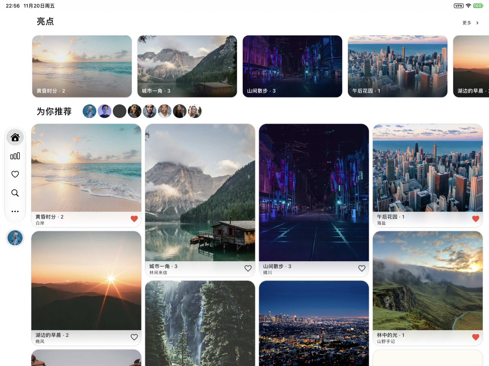
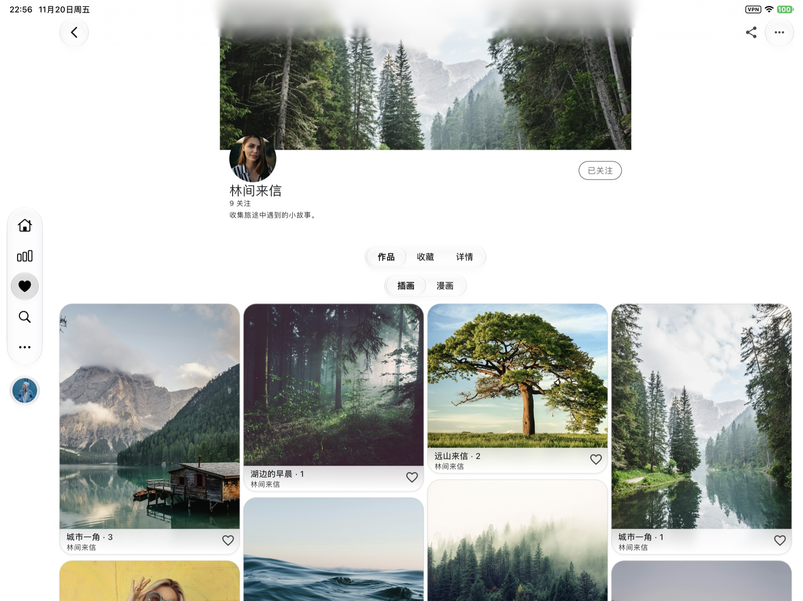
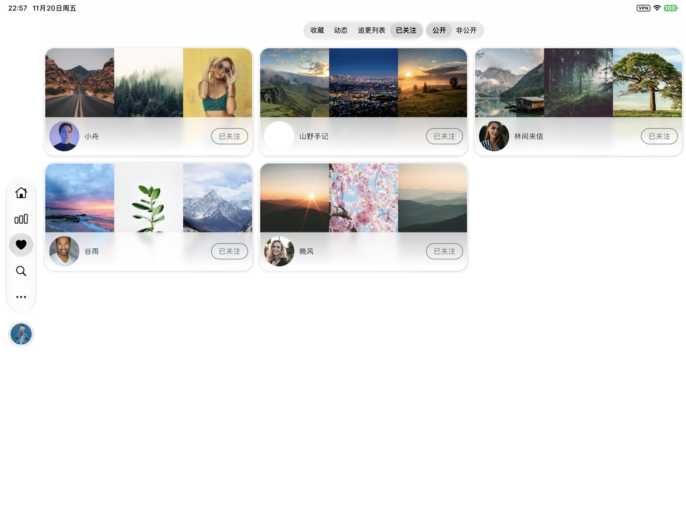
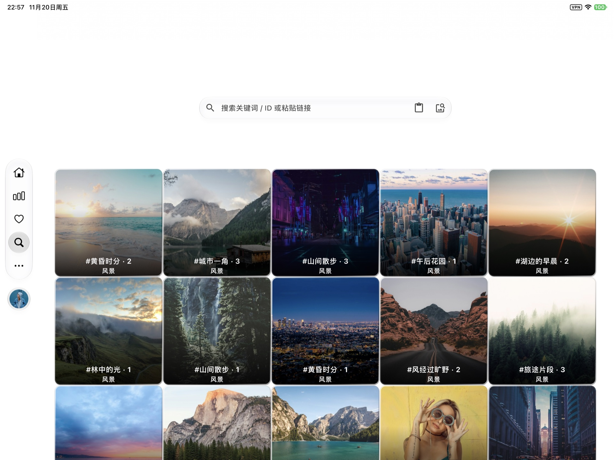
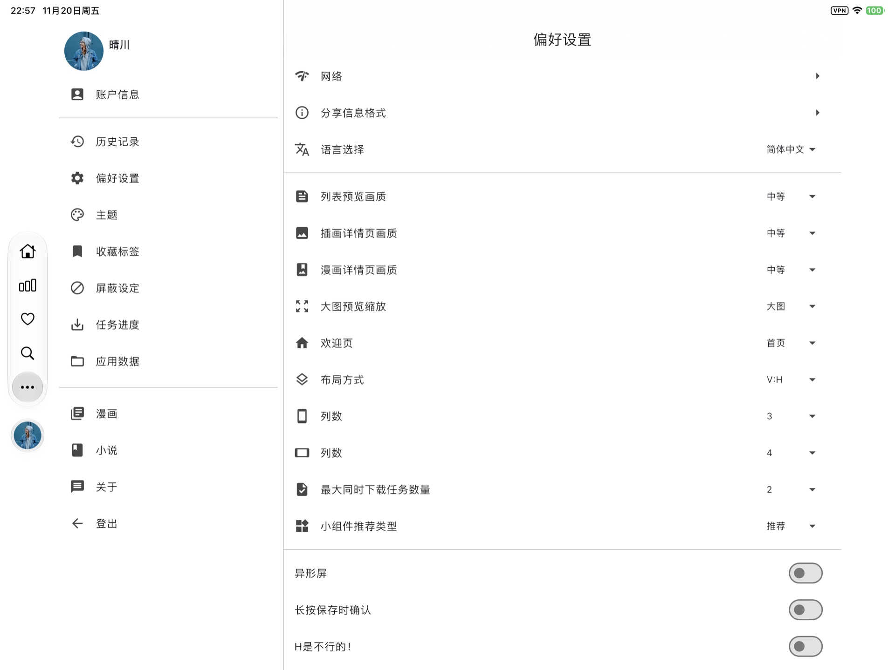

<div align="center">


# PixAP

### 果味的 PixEz · 为 Apple 全面重新设计

以 Apple 最新的界面风格重新设计的 pixiv 第三方客户端。原生液态玻璃（Liquid Glass）融入悬浮导航与工具栏，从首页画廊到作品详情、搜索和设置，整个浏览体验焕然一新。

[下载 IPA](https://github.com/Duke486/PixAP/releases/latest) · [安装说明](#安装) · [问题反馈](https://github.com/Duke486/PixAP/issues)

</div>

> **原项目 [PixEz Flutter](https://github.com/Notsfsssf/pixez-flutter)** 由 Perol_Notsfsssf 发起。PixAP 由 Mark 在其基础上为 Apple 设备改造，沿用 pixiv 接入与客户端功能，重新设计界面和交互。感谢原作者与所有为 PixEz Flutter 编写代码、维护文档和翻译的贡献者。



## 为 Apple 全面重新设计

iPad 横屏用悬浮侧栏连接首页、排行榜、收藏、搜索和更多，从多列画廊点进作品详情，再顺着作者和专题继续探索。设置采用双栏，切换偏好时可以一直看到设置目录。

在 iOS / iPadOS 26 及以上，导航与工具栏使用 SwiftUI 和 UIKit 的原生 Liquid Glass API。玻璃控件随内容呈现透光效果，可交互的材质与导航选中动效回应触控。新版图标采用 Apple Icon Composer 分层资源。

<table>
<tr>
<td width="50%" valign="top">

<h3>从作品找到作者</h3>
<p>在作者主页浏览作品、收藏与资料，插画与漫画分别呈现。</p>
</td>
<td width="50%" valign="top">

<h3>一眼看到关注的作者</h3>
<p>关注列表用作品预览展示每位作者，也能切换到收藏、动态和追更列表。</p>
</td>
</tr>
<tr>
<td width="50%" valign="top">

<h3>从关键词、ID 或链接开始</h3>
<p>搜索入口支持关键词、作品 ID 与 pixiv 链接，下方可直接探索推荐标签。</p>
</td>
<td width="50%" valign="top">

<h3>按自己的习惯浏览</h3>
<p>在双栏设置中调整画质、网格列数和欢迎页，也能从同一侧栏打开漫画与小说。</p>
</td>
</tr>
</table>

## 安装

1. 在 [GitHub Releases](https://github.com/Duke486/PixAP/releases/latest) 下载 `PixAP-iOS.ipa`。
2. 用自己的签名工具为 IPA 签名，再安装到 iPhone 或 iPad。

IPA 为未签名版。推荐在 **iOS / iPadOS 26 或更新版本**体验原生液态玻璃。本次提供 iPhone 与 iPad 安装包。

## 从源码构建

使用带 iOS 26 或更新 SDK 的 Xcode、[mise.toml](mise.toml) 指定的 Flutter 版本，以及 Rust 工具链。执行以下命令构建未签名的设备版，也可以参考 [iOS 构建流程示例](docs/build-workflows/build_ios.yml)。

```sh
flutter pub get
(cd plugins/rhttp/rhttp && flutter pub get && dart run build_runner build)
dart run build_runner build
flutter build ios --release --no-codesign
```

Xcode 工程使用 [Flutter 构建脚本](ios/Flutter/build_with_xcode.sh)。Release 标签附有该 IPA 对应的源码。

## 源码来源、感谢与许可

PixAP 是独立维护的 PixEz Flutter 衍生项目，与 Apple、pixiv 及上游项目无官方关联。上游基线为 [`f11be4dd`](https://github.com/Notsfsssf/pixez-flutter/commit/f11be4ddf03775175006e4b3ebd70c446961f4e6)。Apple 界面重设计于 2026-11-20 首次发布，修改记录见提交历史。

源码按 [GNU GPL v3](LICENSE) 发布。原有版权与许可声明保留在源码中，第三方组件的声明见各组件目录。

<details>
<summary><strong>上游贡献者与文档</strong></summary>


本项目目前的贡献者列表如下：

<table>
  <tr>
    <td align="center"><a href="https://github.com/Notsfsssf"><br /><sub><b>Perol_Notsfsssf</b></sub></a><br /><a href="https://github.com/Skimige/pixez-flutter/commits?author=Notsfsssf" title="Code">💻</a></td>
    <td align="center"><a href="https://xyx.moe"><br /><sub><b>Skimige</b></sub></a><br /><a href="https://github.com/Skimige/pixez-flutter/commits?author=Skimige" title="Documentation">📖</a></td>
    <td align="center"><a href="https://github.com/TragicLifeHu"><br /><sub><b>Tragic Life</b></sub></a><br /><a href="#translation-TragicLifeHu" title="Translation">🌍 (zh_TW)</a></td>
    <td align="center"><a href="http://ivtune.net"><br /><sub><b>karin722</b></sub></a><br /><a href="#translation-karin722" title="Translation">🌍 (ja)</a></td>
    <td align="center"><a href="http://archman.fun"><br /><sub><b>Romani-Archman</b></sub></a><br /><a href="https://github.com/Skimige/pixez-flutter/commits?author=Romani-Archman" title="Documentation">📖</a></td>
    <td align="center"><a href="https://github.com/itzXian"><br /><sub><b>Xian</b></sub></a><br /><a href="#translation-itzXian" title="Translation">🌍 (en_US)</a></td>
    <td align="center"><a href="https://github.com/ReikiAigawara"><br /><sub><b>Reiki Aigawara</b></sub></a><br /><a href="#translation-ReikiAigawara" title="Translation">🌍 (id_ID)</a></td>
  </tr>
</table>

[英文说明](.github/README_en.md) · [印尼语说明](.github/README_id.md) · [常见问题](.github/FAQ.md)

</details>
